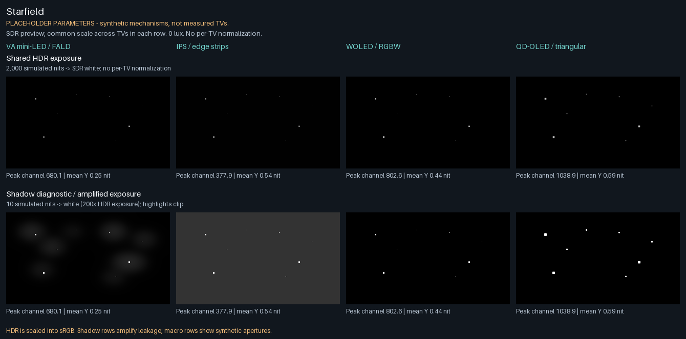

# TV Display Simulator

A reference display simulator built with Python and NumPy. It turns encoded RGB
images into linear-light display output and reproducible previews, illustrating
local dimming, LCD leakage, OLED load limiting, optical spread, temporal response,
viewing angle, motion interpolation, and color volume.

**Research prototype: every shipped TV profile is a placeholder.** The four
presets represent VA mini-LED, IPS edge-lit LCD, WOLED, and QD-OLED mechanisms;
they do not reproduce a named television. Published measurements retain their
own specimen and test conditions. CRT/plasma models, measured spectral/color-volume
calibration, GPU execution, and physically validated native Mac EDR output remain
future work. Browser/PNG previews add the host display's own behavior.

## Quickstart

Python 3.11 or newer is required. From a checkout:

```sh
python3 -m venv .venv
. .venv/bin/activate
python -m pip install -e '.[dev]'
tv-sim --profile generic_woled --input input.png --output output.png
tv-sim provenance --check
tv-sim gallery
```

`python -m tv_sim` provides the same CLI. The former `python -m sim` entry point
is a deprecated compatibility shim; new commands and imports use `tv_sim`.
Open [the offline gallery](reports/gallery/index.html) after generation. The
[CLI guide](docs/usage.md) covers validation, sequences, window fitting, OLED
capacity, [LCD zone dynamics](docs/usage.md#lcd-zone-backlight-dynamics-opt-in),
and opt-in colorimetry.

## Example output

[](reports/gallery/index.html)

The gallery uses one exposure per comparison row. See [bright windows](reports/gallery/bright_window.png),
[synthetic subpixel apertures](reports/gallery/macro_subpixel.png), and
[the M15 color-volume comparison](reports/colorimetry-m15/index.html).
Amplified shadows and macro apertures illustrate mechanisms; they are not
photographs or measured physical emitter dimensions.

A static [web comparison](web/index.html) supports shared brightness mapping,
calibration controls, and exported motion playback. Serve it from the repository
root after exporting its data:

```sh
tv-sim export-web
python -m http.server 8000
# Visit http://localhost:8000/web/
```

Read the [web preview protocol](web/README.md) for HDR and calibration limits.
The [technical explainer](web-explainer/index.html) works offline and introduces
the model with interactive diagrams (Chinese, with English section titles).

## Repository layout

| Path | Purpose |
|---|---|
| `src/tv_sim/` | Installable simulator, CLI, stages, and public API. |
| `src/tv_sim/profiles/` | Generic YAML profiles and versioned evidence sidecars. |
| `src/tv_sim/data/measurements/` | Versioned synthetic protocols and motion settings. |
| `tests/` | Unit, parity/golden, and end-to-end checks. |
| `docs/` | Architecture, usage, profiles, development, decisions, research, and milestone reports. |
| `reports/` | Inspectable generated metrics, galleries, and preview images. |
| `web/`, `web-explainer/` | Browser comparison and offline principles explainer. |

Profiles and protocol data ship with the Python package; loading does not depend
on the current directory. See [profile schema and provenance](docs/profiles.md).

## Development and contributing

```sh
make install
make test
make lint
make typecheck
make docs-check
```

`python -m pytest -q` runs the complete suite. See [test layers](tests/README.md)
and [development setup](docs/development.md) for slow-test selection, formatting,
pre-commit hooks, regeneration, and release checks. Contributions should keep
physical units and provenance explicit and preserve default rendering and golden
outputs. Read [CONTRIBUTING.md](CONTRIBUTING.md) before changing the model.

Start at the [documentation index](docs/index.md), explore the
[research history](docs/research/README.md), or review the [changelog](CHANGELOG.md).
The code is available under the [MIT license](LICENSE); vendored material retains
its own notices.
