# Architecture

The reference implementation is a deterministic NumPy pipeline. Encoded inputs
become linear RGB in nits before spatial, optical, load, and temporal operations.
PNG encoding and browser presentation are separate output transforms. The
[linear-light decision](decisions/0001-linear-light-pipeline.md) records this
boundary; [research](research/06-sim-architecture.md) describes the original
proposal and must be read as a historical design rather than the current order.

## Pipeline stages and data flow

```mermaid
flowchart LR
    A[Encoded RGB] --> B[Decode EOTF]
    B --> C[Scale and sharpen]
    C --> D[Optional sequence reconstruction]
    D --> E[Backlight and optical PSF]
    E --> F[Panel transmission or emission]
    F --> G[HDR shoulder and ABL capacity]
    G --> H[Ambient reflection]
    H --> I[Response and temporal exposure]
    I --> J[Linear RGB nits]
    J --> K[PNG encoding or renderer conversion]
```

1. **Decode:** sRGB, PQ, or HLG code values become linear-light channel values.
   Transfer functions and source primaries are distinct declarations.
2. **Process:** resampling and sharpening operate on the decoded image.
   Requested-content APL is captured before backlight/panel limiting when the
   profile selects the demand load source.
3. **Reconstruct content:** sequences may repeat sources, reconstruct a known
   translation/layer scene, or use the opt-in block-motion proxy. Rational source
   and display clocks remain separate. Source times and cuts obey recorded holds.
4. **Backlight:** LCD zone requests are spread through the selected PSF/LSF and
   boundary policy; emissive profiles use per-pixel drive. Optional M17 dynamics
   first bound and filter persistent zone commands once per display tick, then
   pass the actual illumination map to LCD compensation.
5. **Panel:** LCD transmission includes finite black leakage; OLED emits RGB.
   The opt-in viewing-angle model changes transmission/emission here. Emissive
   optical spread and the legacy matrix/subpixel approximation remain explicit.
6. **HDR/ABL:** the soft shoulder and selected load model limit output. M13 owns
   one optional capacity update per display tick. M15 combines the color envelope
   with that capacity once, avoiding an extra output limiter.
7. **Ambient:** the reflectance model adds room-light luminance.
8. **Temporal:** one persistent pixel history drives response lag, optional
   overdrive, hold, pursuit integration, and BFI. Reconstructed content reaches
   this display history once per output tick.
9. **Output:** `run_linear()` returns a `Frame` containing linear float32 RGB; `run()` adds the
   configured preview encoding. Galleries use a declared common exposure;
   web export writes linear binary16 assets with domain/provenance metadata.

M15 is opt-in and adds source-to-panel RGB/XYZ conversion, gamut mapping and
joint color/HDR capacity within these boundaries. Its signed linear output is
in the declared panel basis; renderers must use the exported conversion
metadata. Disabled paths retain the BT.709 compatibility interpretation.

## Units and state

Images use H×W×3 arrays. Linear channel values use nit-scaled RGB; luminance is
the applicable RGB-to-XYZ Y projection, not any single colored channel. APL is
linear luminance rather than encoded-code average. Optical widths state whether
they use pixels or zone pitches. Pixel temporal configuration uses milliseconds;
M17 zone attack/release constants use seconds and its optional slew cap uses
nits per display tick. Sequence traces preserve rational PTS.

A `Pipeline` holds its profile plus panel/load histories. Optional M13 capacity
state has its own identity and initialization policy. Reusing a pipeline advances
history; constructing a new one starts a separate experiment. Checkpoints retain
the complete history and configuration identity for exact continuation. A fresh
capacity scalar alone cannot resume a physical history.

M17's separate `ZoneTemporalConfig` is default off and leaves the original
backlight arithmetic intact when disabled. Its LCD-only state stores float64
zone commands and the previous bounded targets used by its optional cut
detector. Rising/falling commands use explicit e-fold times; the optional
per-tick slew bound intentionally depends on refresh rate. Cold, settled-first
and explicit-grid initialization start new zone histories. Full checkpoints
preserve exact zone/detector bytes, pixel/load histories and profile/config,
geometry, angle, colorimetry and clock identity for continuation.

The active model bounds zone commands before optical spread; legacy rendering
spreads pooled demand before clipping. These operations can differ for sparse
over-peak inputs even with active zero taus. LCD compensation uses the filtered
illumination, followed by the existing emitted-RGB pixel-response stage. That
cascade does not resolve within-tick LC transmittance and LED timing. Scene cuts
can reset only zone commands when the new shot is actually displayed. M10
leakage/transmission, M15 panel-domain demand/joint capacity and all MEMC modes
keep their own responsibilities. Active OLED M13 capacity, legacy APL smoothing,
backlight tracking, power-proxy derating and M9 fits reject with active M17.
See [the model and evidence limits](research/m17-zone-temporal.md).

## Module map

| Module(s) under `src/tv_sim/` | Responsibility |
|---|---|
| `profile.py`, `profiles/` | Typed runtime schema, bundled profile lookup and YAML/sidecars. |
| `frame.py`, `pipeline.py` | Frame transport, stage orchestration, state and checkpoints. |
| `stages/`, `color.py`, `filters.py`, `load.py` | Transfer, processing, optical, panel, HDR, ambient, and temporal mechanisms. |
| `sequence.py`, `motion.py`, `block_motion.py`, `block_sequence.py` | Rational scheduling, analytic motion and block-proxy reconstruction. |
| `abl_dynamics.py`, `abl_history.py` | Optional global capacity evolution and full-history identity. |
| `zone_temporal.py`, `zone_history.py` | Optional LCD zone command evolution, scene-cut policy and exact full-history continuation. |
| `viewing_angle.py`, `colorimetry.py` | Optional angular and color-volume models. |
| `provenance.py`, `*_provenance.py` | Strict evidence snapshots and protocol validation. |
| `validate.py`, `metrics.py`, `anchors.py`, `patterns.py` | Synthetic M4 protocols, reference comparisons, and numerical metrics. |
| `gallery.py`, `macro.py`, `colorimetry_gallery.py` | Shared-exposure comparisons and illustrative aperture rendering. |
| `window_replay.py`, `oled_dynamics_experiment.py`, `motion_validate.py` | Isolated opt-in experiment runners and artifacts. |
| `zone_temporal_experiment.py` | Synthetic LCD moving/APL/flash/subtitle clips, zone traces, metrics and shared-exposure comparisons. |
| `export_web.py`, `colorimetry_export.py`, `cli.py`, `*_cli.py` | Export contracts and CLI dispatch. |
| `data/measurements/` | Shipped P-only protocol/config records. |

The public package API exposes the core pipeline/profile and opt-in configuration
objects; specialist diagnostics live in their modules. See [usage](usage.md) for
examples. The separate `web/` viewer consumes exported data; `web-explainer/`
contains explanatory models checked against the Python implementation.
